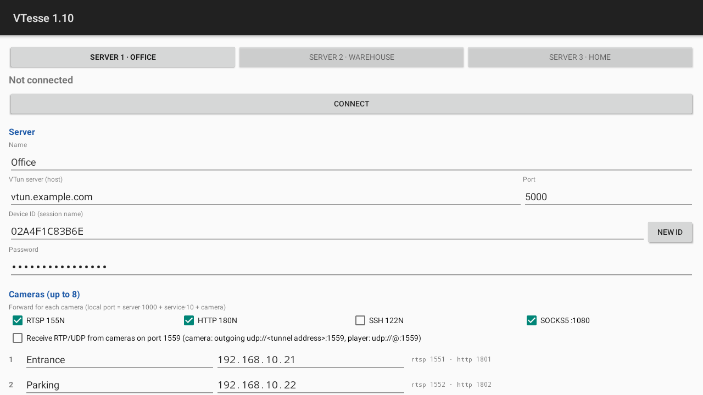

![OpenIPC logo][logo]

# VTesse

**English** | [Русский](README.ru.md) | [简体中文](README.zh-CN.md)

[](https://github.com/compot-dev/vtesse/actions/workflows/build.yml)
[](https://github.com/compot-dev/vtesse/releases/tag/latest)
[](LICENSE.md)
[](docs/architecture.md)
[](docs/security.md)

A resource access microsystem: a client for existing **VTun** servers (`vtund -s`) that works **without a TUN/TAP device and without a system VPN**. The tunnel is terminated inside the application by a userspace TCP/IP stack (lwIP); applications reach remote devices through a local SOCKS5 proxy or port forwards on `127.0.0.1`.

## Features

- **No VPN:** no root, no `/dev/net/tun`, no Android `VpnService` (no VPN icon)
- **VTun:** 3.0.x servers, TCP transport, `type ether` and `type tun` sessions, XOR challenge response, keepalive, automatic reconnection with exponential back-off
- **Network:** address and routes via DHCP through the tunnel (option 121, RFC 3442), IPv4, outbound connections only
- **UDP relay:** RTP pushed by cameras to the tunnel address reaches a local player (`--udp-relay`)
- **Local proxy:** SOCKS5 `CONNECT` with optional username/password, static TCP port forwards (e.g. RTSP over TCP for video players)
- **Targets:** embedded Linux (IP cameras, routers; ARM and MIPS, including big-endian, uClibc/musl), Android, and later an embeddable communication module
- **Library first:** C99 + POSIX, single-threaded, no own main loop — easy to embed

## Download

Static binaries (no dependencies) are on the [releases page](https://github.com/compot-dev/vtesse/releases): [`latest`](https://github.com/compot-dev/vtesse/releases/tag/latest) is rebuilt from every push to `main` (stable file names, used below). The release title shows the VTesse version; the change history is in [CHANGELOG.md](CHANGELOG.md).

| Platform | `ARCH` |
|---|---|
| OpenIPC cameras: HiSilicon, Goke, SigmaStar, other 32-bit ARM; Raspberry Pi with a 32-bit OS | `arm32` |
| OpenIPC cameras: Ingenic (T31 and others); MIPS little-endian routers (MediaTek MT7621, MT7628) | `mipsel` |
| MIPS big-endian routers (Qualcomm Atheros ath79 and others) | `mips` |
| 64-bit ARM: Raspberry Pi with a 64-bit OS, Rockchip, other ARM64 boards | `arm64` |
| PCs and servers | `x86_64` |

Two binaries per platform: `vtesse-ARCH` (lwIP and TAP backends: SOCKS5 / port forwards without root, or a kernel interface with `--tap`) and `vtesse-tap-ARCH` (TAP only, about half the size). The TAP backend needs root and the `tun` driver (`/dev/net/tun`), and the hook scripts `vtesse-hook.sh` and `vtesse-udhcpc.script`.

The releases also carry the VTun server for PCs and servers, `vtund-3.0.2-x86_64`: the original VTun 3.0.2 with our patches (a refused login is logged with the device ID and the reason), see [server/README.md](server/README.md). For cameras and routers vtund is built in the OpenIPC environment when needed.

### Configuration

All installations below read `/etc/vtesse.conf` (the session name is the device ID: 12 characters `0-9A-F`, also used as the MAC):

```sh
cat > /etc/vtesse.conf <<EOF
host=vtun.example.org
port=5555
session=02AB34CD56EF
password=secret
EOF
chmod 600 /etc/vtesse.conf
```

On a camera or router the ID can come from the device's own MAC instead: replace `session=…` with `id_from=eth0` (see [Device ID](docs/usage.md#device-id)).

### OpenIPC camera

```sh
# as root; ARCH = arm32 or mipsel, see the table
ARCH=arm32
URL=https://github.com/compot-dev/vtesse/releases/download/latest
# directories, then each file straight to its place, executable on success
mkdir -p /usr/bin /usr/share/vtesse /etc/init.d
curl -fsSL -o /usr/bin/vtesse $URL/vtesse-tap-$ARCH && chmod 755 /usr/bin/vtesse
curl -fsSL -o /usr/share/vtesse/vtesse-hook.sh $URL/vtesse-hook.sh && chmod 755 /usr/share/vtesse/vtesse-hook.sh
curl -fsSL -o /usr/share/vtesse/vtesse-udhcpc.script $URL/vtesse-udhcpc.script && chmod 755 /usr/share/vtesse/vtesse-udhcpc.script
curl -fsSL -o /etc/init.d/S99vtesse $URL/S99vtesse && chmod 755 /etc/init.d/S99vtesse
vtesse --version
# run in the foreground (Ctrl+C to stop)
vtesse --config /etc/vtesse.conf --tap --ifname vtesse0 --hook /usr/share/vtesse/vtesse-hook.sh
```

Start at boot (`S99vtesse` is already installed; settings can be overridden in `/etc/default/vtesse`):

```sh
/etc/init.d/S99vtesse start
/etc/init.d/S99vtesse status
```

### OpenWrt router

```sh
opkg update && opkg install curl kmod-tun   # kmod-tun is needed for --tap only; apk add curl kmod-tun on OpenWrt 25+
# ARCH = mipsel (MT7621, MT7628), mips (ath79), arm64 or arm32, see the table
ARCH=mipsel
URL=https://github.com/compot-dev/vtesse/releases/download/latest
mkdir -p /usr/bin /usr/share/vtesse /etc/init.d
curl -fsSL -o /usr/bin/vtesse $URL/vtesse-tap-$ARCH && chmod 755 /usr/bin/vtesse
curl -fsSL -o /usr/share/vtesse/vtesse-hook.sh $URL/vtesse-hook.sh && chmod 755 /usr/share/vtesse/vtesse-hook.sh
curl -fsSL -o /usr/share/vtesse/vtesse-udhcpc.script $URL/vtesse-udhcpc.script && chmod 755 /usr/share/vtesse/vtesse-udhcpc.script
curl -fsSL -o /etc/init.d/vtesse $URL/vtesse.init && chmod 755 /etc/init.d/vtesse
/etc/init.d/vtesse enable && /etc/init.d/vtesse start
```

### Linux PC, Raspberry Pi

```sh
ARCH=x86_64   # x86_64; arm64 / arm32 on a Raspberry Pi with a 64-bit / 32-bit OS
mkdir -p ~/.local/bin
curl -fsSL -o ~/.local/bin/vtesse https://github.com/compot-dev/vtesse/releases/download/latest/vtesse-$ARCH && chmod 755 ~/.local/bin/vtesse
# no root needed: SOCKS5 on 127.0.0.1:1080 and a forward to a camera's RTSP
~/.local/bin/vtesse --config /etc/vtesse.conf --socks 1080 --forward 8554:10.78.0.10:554
```

### Android

Android 5.0 and later, including Android TV boxes: [`vtesse-android.apk`](https://github.com/compot-dev/vtesse/releases/download/latest/vtesse-android.apk). No VPN permission and no VPN icon — a service with a regular notification runs the tunnel and offers SOCKS5 and port forwards on `127.0.0.1`; a player such as OpenIPC Decoder or VLC opens e.g. `rtsp://127.0.0.1:1551/...` (camera 1 of server 1). Up to three servers with up to 8 cameras each on fixed ports. The device ID is generated on first start (long press copies it) and must be added as a session on the server. Up to three server profiles, switched with one press. See [android/README.md](android/README.md).



## Build from source

```sh
make
mkdir -p ~/.config/vtesse
cat > ~/.config/vtesse/vtesse.conf <<EOF
host=vtun.example.org
port=5555
session=02AB34CD56EF
password=secret
EOF
chmod 600 ~/.config/vtesse/vtesse.conf

build/vtesse-cli --config ~/.config/vtesse/vtesse.conf --socks 1080 --forward 8554:10.78.0.10:554
curl --socks5 127.0.0.1:1080 http://10.78.0.10/
ffplay -rtsp_transport tcp rtsp://127.0.0.1:8554/stream
```

The session name is the device ID (12 characters `0-9A-F`, also used as the MAC); credentials are read only from the configuration file.

## Documentation

| Document | Contents |
|---|---|
| [Usage](docs/usage.md) | building, `vtesse-cli` options, configuration file, device ID, DHCP and routes, local proxy, error messages, probe tool |
| [VTun protocol](docs/protocol.md) | handshake, challenge response, session flags, framing, keepalive, server behaviour that affects clients, UDP |
| [Architecture](docs/architecture.md) | layers, `tunnel_ops_t`, VTun client, lwIP stack, proxy and flow control, repository layout |
| [Embedding](docs/embedding.md) | using the libraries in another application, loop integration, example |
| [Security](docs/security.md) | VTun authentication weaknesses, clear-text data, local proxy exposure |
| [VTun server](server/README.md) | patched vtund builds, release binaries, patch list |
| [Testing](docs/testing.md) | unit tests, sanitizers, big-endian MIPS, Docker test bench and acceptance tests |

## Roadmap

Stages and tasks are tracked as [GitHub issues](https://github.com/compot-dev/vtesse/issues):

| Stage | Status | Issues |
|---|---|---|
| 0. Test bench (VTun 3.0.2 in Docker, bridge, DHCP with option 121) | ✅ Done | [#1](https://github.com/compot-dev/vtesse/issues/1) ✅ |
| 1. CLI prototype on Linux: TCP + `type ether` + DHCP over lwIP | ✅ Done | [#2](https://github.com/compot-dev/vtesse/issues/2) ✅ [#3](https://github.com/compot-dev/vtesse/issues/3) ✅ [#4](https://github.com/compot-dev/vtesse/issues/4) ✅ [#5](https://github.com/compot-dev/vtesse/issues/5) ✅ [#6](https://github.com/compot-dev/vtesse/issues/6) ✅ [#7](https://github.com/compot-dev/vtesse/issues/7) ✅ [#8](https://github.com/compot-dev/vtesse/issues/8) ✅ |
| 2. Local proxy: SOCKS5 and port forwarding | ✅ Done | [#10](https://github.com/compot-dev/vtesse/issues/10) ✅ [#11](https://github.com/compot-dev/vtesse/issues/11) ✅ |
| 3. Embedded Linux: ARM/MIPS cross builds, footprint, CI | ✅ Done | [#12](https://github.com/compot-dev/vtesse/issues/12) ✅ [#20](https://github.com/compot-dev/vtesse/issues/20) ✅ |
| 3. TAP/TUN backend (kernel interface instead of lwIP, Linux targets) | ✅ Done | [#19](https://github.com/compot-dev/vtesse/issues/19) ✅ |
| 4. Android app (no VpnService) | ✅ Done | [#13](https://github.com/compot-dev/vtesse/issues/13) ✅ |
| 5. Optional: UDP transport, TLS wrapper, Blowfish auth | ⏸ Deferred | [#14](https://github.com/compot-dev/vtesse/issues/14) [#15](https://github.com/compot-dev/vtesse/issues/15) [#16](https://github.com/compot-dev/vtesse/issues/16) |
| 6. Reuse of the upper layers for camex | ⏸ Deferred | [#17](https://github.com/compot-dev/vtesse/issues/17) |
| Cross-cutting: tests, license | ✅ Done | [#9](https://github.com/compot-dev/vtesse/issues/9) ✅ [#18](https://github.com/compot-dev/vtesse/issues/18) ✅ |

✅ — closed issue. ⏸ — deferred.

## License

[The Prosperity Public License 3.0.0](LICENSE.md): free for noncommercial use, with a 30-day trial for commercial use. See [LICENSE.md](LICENSE.md) for the full terms. Third-party code keeps its own license (lwIP: BSD-3-Clause).

## Support

- Questions and bug reports: [GitHub Issues](https://github.com/compot-dev/vtesse/issues)
- Documentation: [docs/](docs/)

[](https://openipc.org/our-channels)

[logo]: https://raw.githubusercontent.com/OpenIPC/.github/refs/heads/main/assets/openipc-logo-black.svg
